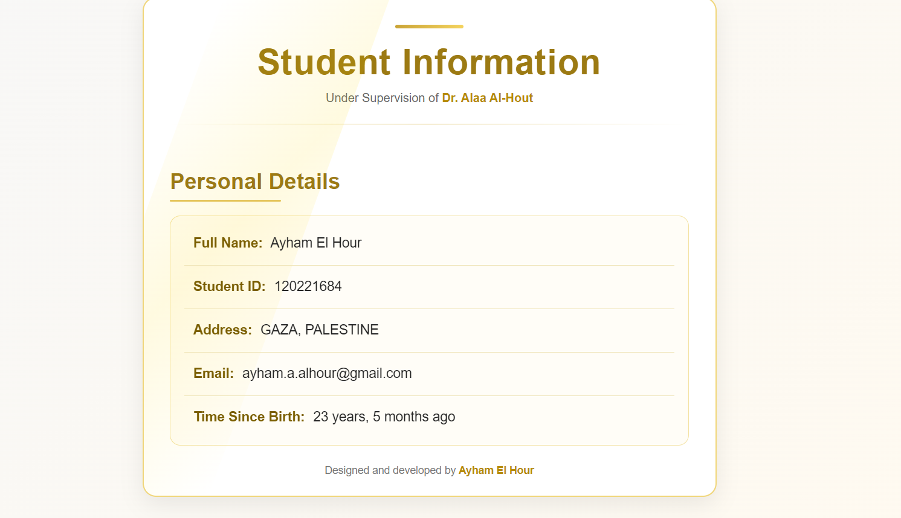
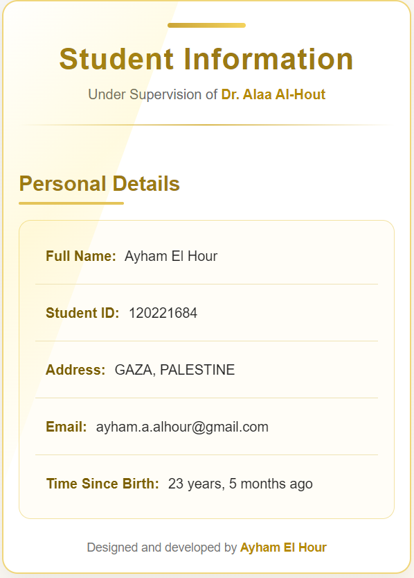

<div align="center">

### WEB PROGRAMMING 3 · WEEKLY ASSIGNMENT

# ✦ Django Templates & Context ✦

**A student profile built with Django Template Language**

*Simple Python logic. Reusable HTML templates. A touch of gold.*

<p>
  
  
  
  
</p>

**Ayham El Hour** · **Student ID: 120221684**\
**Under the supervision of Dr. Alaa Al-Hout**

</div>

---

## ✨ Project preview

A responsive student-information card with a white-and-gold theme, subtle animations, and data rendered from Django views.

<div align="center">
  
</div>

<details>
<summary><strong>📱 View the mobile layout</strong></summary>
<br />
<div align="center">
  
</div>
</details>

## 📖 About the assignment

This project was created for a Web Programming 3 assignment to practice rendering HTML templates in Django, passing data through a **context dictionary** in a view, and formatting values with **Django Template Language (DTL) filters**.

The student information is defined in `pages/views.py` and passed to `Templates/pages/index.html` using `render()`. The page inherits its main layout from `base.html` and includes a reusable `footer.html`.

### Assignment requirements

- A Django project named `project` and an app named `pages`
- A template at `Templates/pages/index.html`
- Student information passed from the view using a `context` dictionary
- Dynamic values displayed with `{{ variable_name }}`
- Required template filters for the name, student ID, address, email, and date of birth
- Organized templates using `extends`, `block`, and `include`

## 🧩 Django filters

| Field | Template expression | Purpose |
| :--- | :--- | :--- |
| Full name | `{{ first_name\|capfirst\|add:" "\|add:last_name }}` | Capitalize the first name and append the surname |
| Student ID | `{{ student_id\|stringformat:"s" }}` | Display the ID as text |
| Address | `{{ address\|upper }}` | Convert the address to uppercase |
| Email | `{{ email\|default:"Not provided" }}` | Display a fallback for an empty email |
| Date of birth | `{{ date_of_birth\|timesince }}` | Show the time elapsed since birth |

## 🗂️ Project structure

```text
.
├── manage.py
├── requirements.txt
├── .gitignore
├── project/
│   ├── settings.py
│   ├── urls.py
│   ├── asgi.py
│   └── wsgi.py
├── pages/
│   ├── views.py
│   ├── urls.py
│   ├── apps.py
│   ├── admin.py
│   ├── models.py
│   ├── tests.py
│   └── migrations/
├── Templates/
│   └── pages/
│       ├── base.html       # Shared layout and styling
│       ├── index.html      # Student information and DTL filters
│       └── footer.html     # Reusable author footer
└── docs/
    └── screenshots/
        ├── desktop.png
        └── mobile.png
```

### How the templates work

```text
Browser request
      ↓
   URL route
      ↓
pages/views.py  →  context dictionary
      ↓
render('pages/index.html', context)
      ↓
index.html  →  extends base.html
      ↓
       includes footer.html
      ↓
   HTML response
```

`base.html` holds the shared HTML structure and CSS. `index.html` contains the page-specific content inside `` and calls `` to show the author footer.

## 🚀 Run locally

**1. Clone the repository**

```bash
git clone https://github.com/MR7PRO/django-templates-context-assignment-.git
cd django-templates-context-assignment-
```

**2. Create and activate a virtual environment (Windows CMD)**

```bat
python -m venv venv
venv\Scripts\activate
```

**3. Install dependencies**

```bash
python -m pip install -r requirements.txt
```

**4. Apply the default Django migrations**

```bash
python manage.py migrate
```

**5. Start the development server**

```bash
python manage.py runserver
```

Open **http://127.0.0.1:8000/** in your browser.

> **Development note:** This assignment is intended to run locally. Its Django development settings are not configured for production deployment. The secret key is read from `DJANGO_SECRET_KEY` when provided; otherwise, a temporary key is generated for local testing. Virtual environments and the local SQLite database are excluded by `.gitignore`.

---

<div align="center">

### ✦ Designed & Developed by ✦

## **Ayham El Hour**

*Web Programming 3 · Django Assignment*\
**Student ID:** 120221684\
**Supervisor:** Dr. Alaa Al-Hout\
**Gaza, Palestine**

<a href="https://github.com/MR7PRO">GitHub Profile ↗</a>

<sub>Built as a practical learning project using the concepts covered in the course.</sub>

</div>
